# CarneCerta


Escolha o corte certo e leve a quantidade certa ao açougue.

O CarneCerta é um app acadêmico que ajuda a escolher o corte de carne pelo método de preparo. A pessoa responde poucas perguntas, recebe um Top 3 de cortes e monta uma ficha de compra para mostrar ao açougueiro.

## Sumário

1. [Visão geral](#visão-geral)
2. [Telas do aplicativo](#telas-do-aplicativo)
3. [Fluxo do usuário](#fluxo-do-usuário)
4. [Lógica de escolha](#lógica-de-escolha)
5. [Árvore do projeto](#árvore-do-projeto)
6. [Galeria de carnes](#galeria-de-carnes)
7. [Instalação e execução](#instalação-e-execução)
8. [Estrutura de dados](#estrutura-de-dados)
9. [Testes](#testes)
10. [Acessibilidade](#acessibilidade)
11. [Autores](#autores)

## Visão geral

<table>
<tr bgcolor="#E8B4B8"><th align="left">Item</th><th align="left">Descrição</th><th align="left">Tecnologia</th></tr>
<tr bgcolor="#F5D5D8"><td>Plataforma</td><td>Android, iOS e web, com o mesmo código</td><td>Expo SDK 58, React Native 0.88, React Native Web</td></tr>
<tr bgcolor="#FFFFFF"><td>Linguagem</td><td>Código tipado em todas as telas e regras</td><td>TypeScript 6.0</td></tr>
<tr bgcolor="#F5D5D8"><td>Navegação</td><td>Pilha de telas, sem cabeçalho nativo</td><td>React Navigation (native-stack)</td></tr>
<tr bgcolor="#FFFFFF"><td>Banco local</td><td>Guarda o carrinho e as fichas salvas no aparelho</td><td>expo-sqlite</td></tr>
<tr bgcolor="#F5D5D8"><td>Acessibilidade</td><td>Tradução de textos para Libras</td><td>VLibras (widget oficial), react-native-webview</td></tr>
<tr bgcolor="#FFFFFF"><td>Testes</td><td>Script que confere as regras de escolha e de quantidade</td><td><code>data/testeEscolha.ts</code>, rodado com <code>tsc</code> e <code>node</code></td></tr>
</table>

## Telas do aplicativo

<table>
<tr>
<td align="center">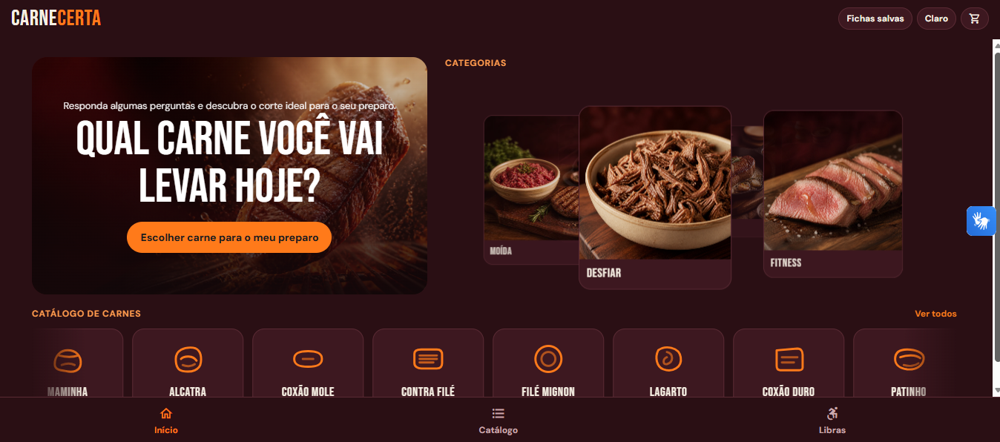<br><b>Início (web)</b></td>
<td align="center">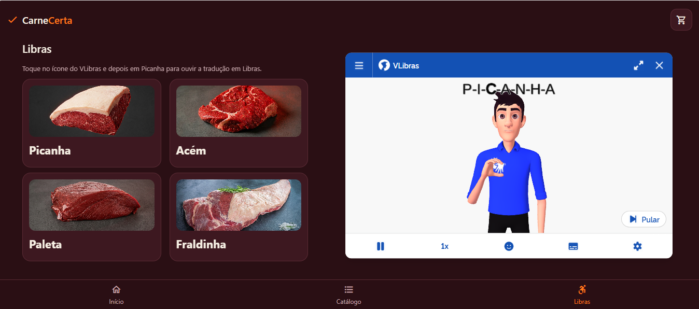<br><b>Libras (web)</b></td>
</tr>
</table>

<table>
<tr><td align="center">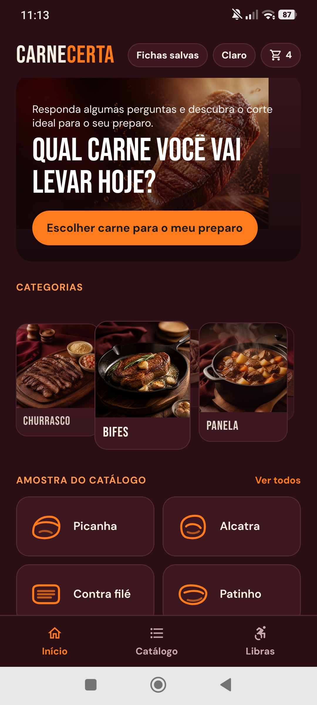<br><b>Início (escuro)</b></td><td align="center"><br><b>Início (claro)</b></td><td align="center"><br><b>Escolha: pessoas</b></td></tr>
<tr><td align="center"><br><b>Escolha: prioridade</b></td><td align="center"><br><b>Escolha: espessura</b></td><td align="center"><br><b>Top 3</b></td></tr>
<tr><td align="center"><br><b>Ficha de compra</b></td><td align="center">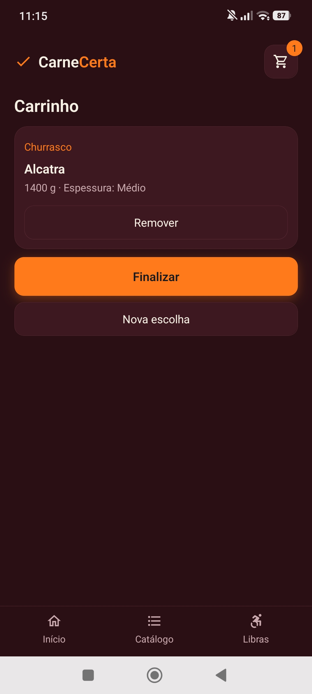<br><b>Carrinho</b></td><td align="center"><br><b>Libras</b></td></tr>
</table>

## Fluxo do usuário

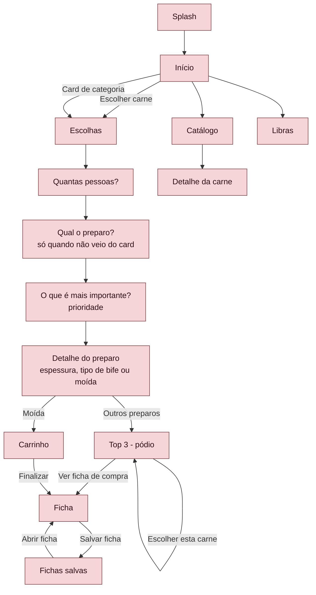

O cabeçalho de todas as telas leva ao Carrinho e às Fichas salvas. O menu de baixo leva ao Início, ao Catálogo e à tela de Libras.

## Lógica de escolha

Regras de `data/escolha.ts`.

<table>
<tr bgcolor="#E8B4B8"><th align="left">Regra</th><th align="left">Como funciona</th></tr>
<tr bgcolor="#F5D5D8"><td>Prioridade</td><td>Uma só: Economia, Derrete na boca (maciez), Explosão de sabor (sabor) ou Leve (magra).</td></tr>
<tr bgcolor="#FFFFFF"><td>Pontuação</td><td>Nota da prioridade × 2, mais a nota de economia quando a prioridade é Economia, mais 1 se a carne é do preparo. Empate: vence a maior nota de sabor.</td></tr>
<tr bgcolor="#F5D5D8"><td>Top 3</td><td>As 3 carnes de maior pontuação do preparo. Com menos de 3, completa com as outras, pela mesma pontuação.</td></tr>
<tr bgcolor="#FFFFFF"><td>Quantidade por pessoa</td><td>Churrasco 350 g. Moída 250 g. Bifes, Panela, Desfiar e Fitness 150 g.</td></tr>
<tr bgcolor="#F5D5D8"><td>Faixas de pessoas</td><td>1 a 3 usa 1. 4 a 6 usa 4. 7 a 10 usa 7. Mais de 10 usa o número digitado, mínimo 11.</td></tr>
<tr bgcolor="#FFFFFF"><td>Total</td><td>Pessoas usadas × gramas por pessoa.</td></tr>
<tr bgcolor="#F5D5D8"><td>Arredondamento</td><td>Sempre para cima, em múltiplos de 100 g.</td></tr>
<tr bgcolor="#FFFFFF"><td>Unidade</td><td>Gramas até 10 pessoas, kg acima disso. Decidida pela ficha inteira, não por linha.</td></tr>
<tr bgcolor="#F5D5D8"><td>Churrasco</td><td>Pergunta a espessura: Fino, Médio ou Grosso.</td></tr>
<tr bgcolor="#FFFFFF"><td>Bifes</td><td>Pergunta o tipo: Bife de chapa, Bife fino ou Bife à milanesa.</td></tr>
<tr bgcolor="#F5D5D8"><td>Hambúrguer</td><td>Sempre duas carnes, pelo blend: Saborosa + magra (Peito bovino + Patinho), Duas saborosas (Peito bovino + Músculo) ou Duas magras (Patinho + Coxão duro). Cada carne leva metade do total, arredondada para cima de 100 g.</td></tr>
<tr bgcolor="#FFFFFF"><td>Moída sem hambúrguer</td><td>Uma carne só, escolhida entre as de moagem, moída 1 ou 2 vezes. Total arredondado para cima de 100 g.</td></tr>
<tr bgcolor="#F5D5D8"><td>Pódio (Top 3)</td><td>Mostra a foto de cada carne definida em <code>data/imagensCategorias.ts</code>.</td></tr>
<tr bgcolor="#FFFFFF"><td>Peso salvo</td><td>O carrinho e as fichas guardam só as escolhas. O peso é recalculado ao abrir.</td></tr>
</table>

Exemplos:

<table>
<tr bgcolor="#E8B4B8"><th align="left">Pedido</th><th align="left">Conta</th><th align="left">Ficha</th></tr>
<tr bgcolor="#F5D5D8"><td>2 pessoas, churrasco</td><td>1 × 350 = 350</td><td>400 g</td></tr>
<tr bgcolor="#FFFFFF"><td>8 pessoas, churrasco</td><td>7 × 350 = 2450</td><td>2500 g</td></tr>
<tr bgcolor="#F5D5D8"><td>12 pessoas, churrasco</td><td>12 × 350 = 4200</td><td>4,2 kg</td></tr>
<tr bgcolor="#FFFFFF"><td>15 pessoas, hambúrguer</td><td>15 × 250 = 3750, metade 1875</td><td>1,9 kg + 1,9 kg = 3,8 kg</td></tr>
</table>

## Árvore do projeto

```text
carnecerta/
├── App.tsx                  # navegação e provedores
├── package.json
├── README.md
├── screens/
│   ├── TelaSplash.tsx
│   ├── TelaInicial.tsx
│   ├── TelaEscolhas.tsx     # perguntas
│   ├── TelaRecomendacao.tsx # Top 3 (pódio)
│   ├── TelaCarrinho.tsx
│   ├── TelaFicha.tsx        # ficha atual e ficha salva
│   ├── TelaFichasSalvas.tsx
│   ├── TelaCatalogo.tsx
│   ├── TelaDetalhe.tsx
│   ├── TelaLibras.tsx
│   └── rotas.ts
├── components/
│   ├── Tela.tsx             # cabeçalho, menu e rodapé
│   ├── VLibrasWidget.tsx
│   ├── tema.ts              # temas escuro e claro
│   └── ui.tsx
├── contexto/
│   └── AppContexto.tsx      # carrinho e tema
├── data/
│   ├── banco.ts             # expo-sqlite
│   ├── carnes.ts
│   ├── categorias.ts
│   ├── escolha.ts           # regras de escolha e quantidade
│   ├── imagensCategorias.ts # fotos das categorias e das carnes
│   └── testeEscolha.ts
├── assets/
│   ├── categorias/
│   └── imagens/
└── docs/
    ├── diagnostico-gramas.md
    ├── fichas-salvas.md
    └── relatorio-testes.md
```

## Galeria de carnes

Fotos usadas no catálogo, no pódio e no detalhe. As carnes de cada categoria seguem `data/carnes.ts`.

<table>
<tr bgcolor="#E8B4B8"><th align="left">Categoria</th><th align="left">Carnes</th></tr>
<tr bgcolor="#F5D5D8"><td align="center" width="140">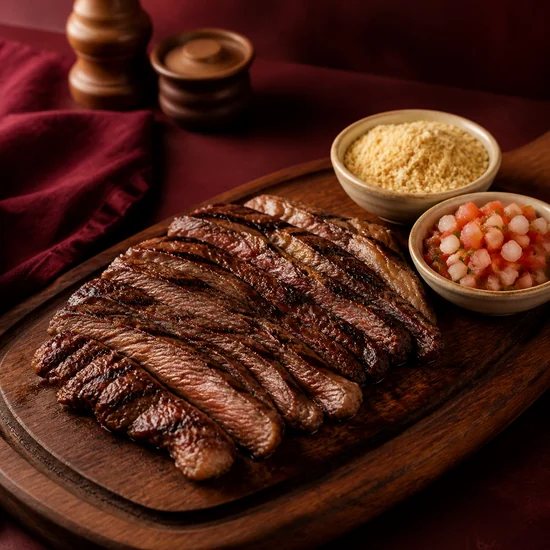<br><b>Churrasco</b></td><td> Picanha&nbsp;&nbsp;&nbsp; Alcatra&nbsp;&nbsp;&nbsp; Contra filé&nbsp;&nbsp;&nbsp; Fraldinha&nbsp;&nbsp;&nbsp;</td></tr>
<tr bgcolor="#FFFFFF"><td align="center" width="140">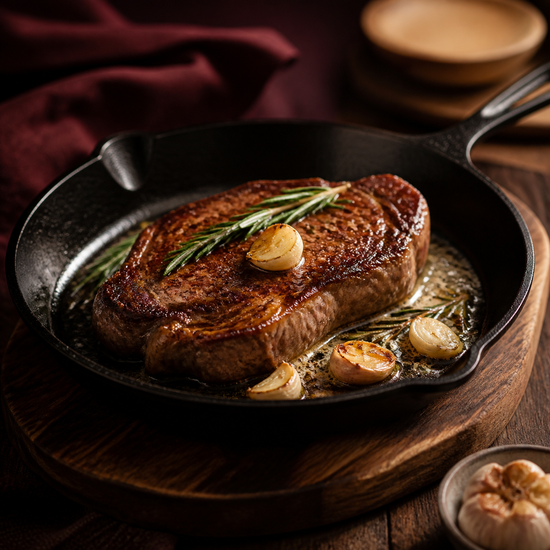<br><b>Bifes</b></td><td> Alcatra&nbsp;&nbsp;&nbsp; Contra filé&nbsp;&nbsp;&nbsp; Filé mignon&nbsp;&nbsp;&nbsp; Coxão mole&nbsp;&nbsp;&nbsp;</td></tr>
<tr bgcolor="#F5D5D8"><td align="center" width="140">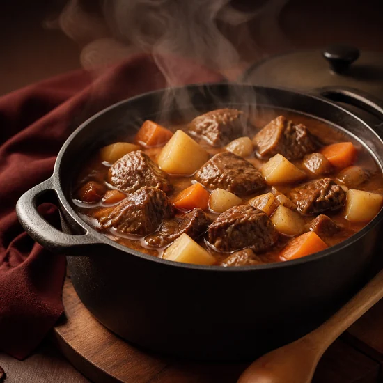<br><b>Panela</b></td><td> Acém&nbsp;&nbsp;&nbsp; Paleta&nbsp;&nbsp;&nbsp; Músculo&nbsp;&nbsp;&nbsp; Peito bovino&nbsp;&nbsp;&nbsp; Coxão duro&nbsp;&nbsp;&nbsp;</td></tr>
<tr bgcolor="#FFFFFF"><td align="center" width="140">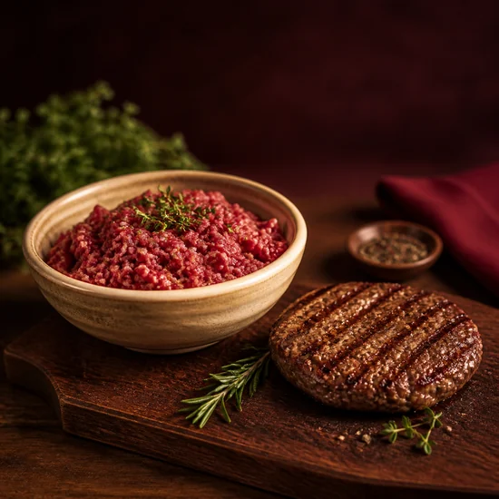<br><b>Moída</b></td><td> Coxão mole&nbsp;&nbsp;&nbsp; Patinho&nbsp;&nbsp;&nbsp;</td></tr>
<tr bgcolor="#F5D5D8"><td align="center" width="140">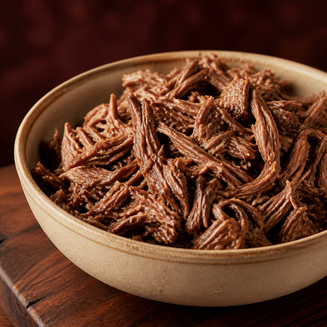<br><b>Desfiar</b></td><td> Fraldinha&nbsp;&nbsp;&nbsp; Acém&nbsp;&nbsp;&nbsp; Paleta&nbsp;&nbsp;&nbsp; Coxão duro&nbsp;&nbsp;&nbsp;</td></tr>
<tr bgcolor="#FFFFFF"><td align="center" width="140">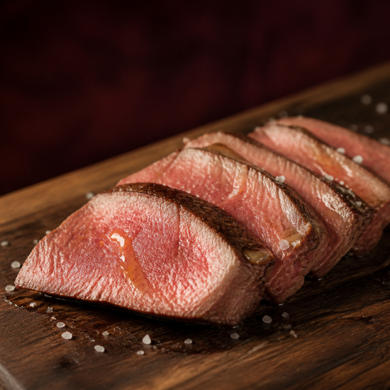<br><b>Fitness</b></td><td> Músculo&nbsp;&nbsp;&nbsp; Patinho&nbsp;&nbsp;&nbsp; Lagarto&nbsp;&nbsp;&nbsp;</td></tr>
</table>

## Instalação e execução

Requisitos: Node.js e npm. Para o celular, o app Expo Go.

1. Instale as dependências:

   ```bash
   npm install
   ```

2. Inicie o servidor do Expo, limpando o cache:

   ```bash
   npx expo start -c
   ```

3. Abra o app:
   - No navegador: tecle `w` no terminal do Expo.
   - No celular: abra o Expo Go e leia o QR code do terminal.

Scripts do `package.json`:

<table>
<tr bgcolor="#E8B4B8"><th align="left">Comando</th><th align="left">O que faz</th></tr>
<tr bgcolor="#F5D5D8"><td><code>npm start</code></td><td><code>expo start</code></td></tr>
<tr bgcolor="#FFFFFF"><td><code>npm run android</code></td><td><code>expo start --android</code></td></tr>
<tr bgcolor="#F5D5D8"><td><code>npm run ios</code></td><td><code>expo start --ios</code></td></tr>
<tr bgcolor="#FFFFFF"><td><code>npm run web</code></td><td><code>expo start --web</code></td></tr>
<tr bgcolor="#F5D5D8"><td><code>npm run lint</code></td><td><code>expo lint</code></td></tr>
</table>

## Estrutura de dados

Banco `carnecerta.db`, em `data/banco.ts`.

<table>
<tr bgcolor="#E8B4B8"><th align="left">Tabela</th><th align="left">Colunas</th><th align="left">Para que serve</th></tr>
<tr bgcolor="#F5D5D8"><td><code>kv</code></td><td><code>chave</code> (texto, chave primária), <code>valor</code> (texto)</td><td>Guarda o carrinho atual na chave <code>carrinho</code>, em JSON.</td></tr>
<tr bgcolor="#FFFFFF"><td><code>fichas</code></td><td><code>id</code> (inteiro, automático), <code>criada_em</code> (data ISO), <code>dados</code> (JSON)</td><td>Guarda cada ficha salva, da mais recente para a mais antiga.</td></tr>
</table>

Os itens guardam só as escolhas: carnes, preparo, faixa, pessoas, espessura, tipo de bife, hambúrguer, blend e moagem. O peso é recalculado com as regras atuais ao abrir. Se o banco não abrir em 5 segundos (por exemplo, na web), o app segue sem salvar.

## Testes

`data/testeEscolha.ts` confere as regras do app contra regras escritas à mão no próprio teste. Nenhuma tela importa esse arquivo.

Para rodar (troque `<pasta>` por uma pasta de saída fora do projeto):

```bash
npx tsc data/testeEscolha.ts --ignoreConfig --outDir <pasta> --module commonjs --target es2020 --skipLibCheck
node <pasta>/testeEscolha.js
```

<table>
<tr bgcolor="#E8B4B8"><th align="left">Grupo</th><th align="left">O que confere</th></tr>
<tr bgcolor="#F5D5D8"><td>Tabela de carnes</td><td>As 13 carnes, notas, categorias e carnes de moagem.</td></tr>
<tr bgcolor="#FFFFFF"><td>Combinações do fluxo</td><td>Todas as faixas (1, 4, 7, 11 e 25 pessoas), preparos e prioridades, com Fino, Médio e Grosso no churrasco e os 3 tipos de bife. Confere o Top 3, a ordem, o peso e a unidade.</td></tr>
<tr bgcolor="#F5D5D8"><td>Moída</td><td>Os 3 blends de hambúrguer, com duas linhas na ficha e o peso de cada carne, e todas as carnes de moagem, moídas 1 e 2 vezes.</td></tr>
<tr bgcolor="#FFFFFF"><td>Ficha</td><td>Soma de itens iguais, linhas separadas por preparo e total geral.</td></tr>
<tr bgcolor="#F5D5D8"><td>Ordem dos blends</td><td>Ordem por prioridade.</td></tr>
<tr bgcolor="#FFFFFF"><td>Casos de conferência</td><td>Os 10 casos de <code>docs/diagnostico-gramas.md</code>: linhas, total e subtítulo.</td></tr>
<tr bgcolor="#F5D5D8"><td>Unidade e fichas antigas</td><td>Unidade decidida pela ficha inteira. Ficha salva antiga recalculada ao abrir.</td></tr>
</table>

Resultados:

<table>
<tr bgcolor="#E8B4B8"><th align="left">Fonte</th><th align="left">Data</th><th align="left">Resultado</th></tr>
<tr bgcolor="#F5D5D8"><td><code>docs/relatorio-testes.md</code></td><td>06/11/2026</td><td>327 casos: 327 passaram, 0 falharam. Checagem de tipos sem erros. Build web sem erros.</td></tr>
<tr bgcolor="#FFFFFF"><td><code>docs/diagnostico-gramas.md</code> (após a correção das gramas)</td><td>09/11/2026</td><td>340 casos: 340 passaram, 0 falharam.</td></tr>
</table>

Checagem de tipos e lint:

```bash
npx tsc --noEmit
npx expo lint
```

## Acessibilidade

<table>
<tr bgcolor="#E8B4B8"><th align="left">Tela</th><th align="left">Onde</th><th align="left">O que o avatar fala</th></tr>
<tr bgcolor="#F5D5D8"><td><code>TelaLibras.tsx</code></td><td>Card da Picanha, com o widget do VLibras visível</td><td>"Picanha. É um corte bovino da parte de cima do traseiro. É macia e suculenta, com uma capa de gordura. É muito usada no churrasco, na brasa."</td></tr>
<tr bgcolor="#FFFFFF"><td><code>TelaLibras.tsx</code></td><td>Card do Acém, com o widget sobre o card inteiro</td><td>"Acém. É um corte bovino da parte do pescoço. É ideal para cozidos e ensopados. Fica macio quando cozinhado devagar, na panela."</td></tr>
<tr bgcolor="#F5D5D8"><td><code>TelaDetalhe.tsx</code></td><td>Detalhe aberto a partir da tela de Libras</td><td>Mostra o vídeo em Libras da carne, se cadastrado. Hoje todas as carnes mostram "Vídeo em Libras ainda não cadastrado".</td></tr>
</table>

O widget usa o script oficial do VLibras (`vlibras.gov.br`). Os botões do pódio têm rótulo de acessibilidade, por exemplo "Escolher Picanha".

## Autores

- Erika Anastacio Creatto
- Felipe Ferreira de França
- Mateus Henrique de Campos Rumão
- Reinaldo Gomez de Souza

---

> **Porque escolher uma carne não deveria ser difícil, deveria ser simples, deveria ser para todos!**